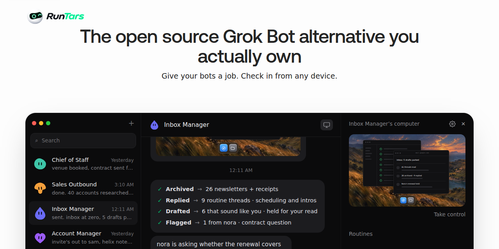

# RunTars

[](https://github.com/lovelybowen/runtars/stargazers)
[](https://github.com/lovelybowen/runtars/releases/download/android/runtars.apk)



RunTars เป็น AI agent โอเพนซอร์สสำหรับ bot ที่ทำงานต่อเนื่องและผู้ช่วยที่ self-host บนเครื่องคุณ มีบนเว็บ เดสก์ท็อป Electron และ Android นำโมเดลและ computer provider มาเองหรือรันทั้งสแต็ก local ได้

รายละเอียดเพิ่มที่ [runtars.com](https://runtars.com)

## เริ่มเร็ว (published images)

ต้องมี Docker Engine, Compose plugin, curl และ OpenSSL ไม่ต้อง clone หรือติดตั้ง Node

```bash
export RAKAZO_IMAGE_TAG=vX.Y.Z # Replace with a published RunTars release tag.
mkdir -p runtars && cd runtars &&
curl -fsSLO https://raw.githubusercontent.com/lovelybowen/runtars/${RAKAZO_IMAGE_TAG}/infra/compose/install-images.sh &&
bash install-images.sh
```

สคริปต์ดาวน์โหลด Compose สร้าง `.env` พร้อม secret แบบสุ่ม แล้วสตาร์ท RunTars รันซ้ำจะเก็บ `.env` เดิมไว้

เปิด [http://127.0.0.1:5173](http://127.0.0.1:5173) สมัครบัญชี แล้วเชื่อมโมเดล Docker computers เปิดอยู่ตามค่าเริ่มต้น

แท็ก image ค่าเริ่มต้นคือ `edge` รายละเอียดติดตั้งบนเซิร์ฟเวอร์ดู [คู่มือ self-host](./docs/th-TH/self-host.md)

## รันบนเซิร์ฟเวอร์

bot ทำงานต่อเมื่อ backend รันบนเซิร์ฟเวอร์ ใช้ installer เดียวกันบน VPS แล้วเชื่อมจากเดสก์ท็อป มือถือ หรือเบราว์เซอร์

```bash
bash install-images.sh --prepare-only
# edit .env: SANDBOX_PROVIDER=boat (or e2b / daytona / createos) with its API key, RAKAZO_HOST=your.domain
bash install-images.sh
```

ใส่ HTTPS หน้า port 5173 ในแอปเดสก์ท็อปเลือก **Existing instance** แล้วใส่ที่อยู่ `https://`

## ภาษา UI

หากต้องการใช้ภาษาไทยบนเว็บหรือในแอปเดสก์ท็อป ให้เลือก **ไทย** ใน **ตั้งค่า (Settings) → Language**

## เอกสาร

- [Self-host](./docs/th-TH/self-host.md)
- [การตั้งค่า](./docs/th-TH/self-host-configuration.md)
- [Secrets](./docs/th-TH/self-host-secrets.md)
- [บัญชีและการลงชื่อเข้าใช้](./docs/th-TH/self-host-accounts.md)
- [โมเดล](./docs/th-TH/self-host-models.md)
- [Production](./docs/th-TH/self-host-production.md)
- [สำรองและกู้คืน](./docs/th-TH/self-host-backups.md)
- [อัปเกรด](./docs/th-TH/self-host-upgrading.md)
- [แก้ปัญหา](./docs/th-TH/troubleshooting.md)
- [เริ่มต้นใช้งาน](./docs/th-TH/getting-started.md)
- [Bot และแชท](./docs/th-TH/bots-and-chats.md)
- [เชื่อมแอป](./docs/th-TH/integrations.md)
- [Routines](./docs/th-TH/routines.md)
- [การอนุมัติ](./docs/th-TH/approvals.md)
- [คอมพิวเตอร์ของ bot](./docs/th-TH/computer.md)
- [ความจำ](./docs/th-TH/memory.md)
